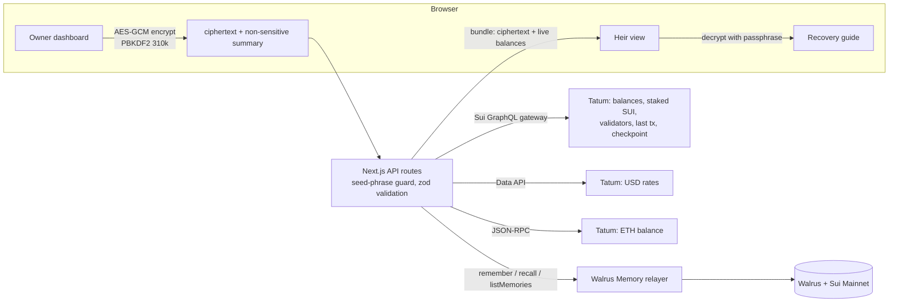

# Next of Kin

**Keys open wallets. Memory finds them.**

An agent that learns what your family would need to know about your crypto. It reads your wallets through Tatum and asks one question at a time, starting with the one that protects the most money. Each answer is encrypted in your browser and kept as a memory on Walrus. If you stop checking in and your wallets go quiet on-chain, it releases a step-by-step recovery guide to your heir.

It never stores keys or seed phrases.

Built for **Total Recall** (Tatum × Walrus), Consumer Finance track.

- Live demo: _added at deploy_
- Mainnet proof: `/proof` on the live demo
- Licence: MIT

> Every memory in this demo describes a real Mainnet position.

---

## The problem

In Nigeria every bank asks for your next of kin. None of them ask what your next of kin will need to know.

When a crypto holder dies, the family usually has keys at best. What they lack is knowledge:

- which wallets exist, and on which chains
- that some SUI is staked and has to be withdrawn before it can be moved
- where the hardware wallet or recovery sheet is kept
- who was meant to get what

Tools such as Shardium, Deadhand and Sarcophagus solve the key problem: seed-phrase splitting and dead man's switches. Nobody solves the knowledge problem. Next of Kin does.

## 60-second tour for judges

1. Open **`/proof`**. Every memory is listed with a Walruscan link. You can see the agent's public key, the relayer's health, the Tatum call counter and the latest Sui checkpoint, read live through Tatum.
2. Press **Rebuild now**. The server throws away its cache and recovers every memory from Walrus alone, then compares the count with the relayer's inventory.
3. Open **`/heir`**. Before release it shows only that the letter is sealed and when the owner last showed signs of life. After release it asks for the passphrase and decrypts the letter and recovery guide in the browser, with live balances.
4. Read the **readiness chart** on the owner dashboard (screenshot below). Each point is a `snapshot` memory written when the score changed.

## How it works



### The learning loop

1. **Scan.** Tatum reads every wallet: coin balances, staked SUI with validator names, USD prices and the latest outgoing transaction.
2. **Ask.** The question engine ranks what the agent doesn't know yet by money at stake. Drift comes first, then the answer that raises readiness most, then each question's share of what is still uncovered. You answer one question at a time.
3. **Remember.** The answer is encrypted in the browser and written to Walrus Memory. You see the receipt go from _writing_ to _kept on Walrus_, with a blob ID.
4. **Verify against the chain.** Each answer records the balances it was given against. If a balance later falls below 75% or rises above 133% of that baseline, or disappears, the asset stops counting and the agent asks about it first. One click resolves it ("still accurate", "I moved it", "I spent it"), and that confirmation is itself a memory.
5. **Measure.** Readiness is recomputed and a `snapshot` memory is written whenever it moves by a point or more. The chart on the dashboard is built only from those memories.

### Readiness formula

Deterministic. No LLM anywhere.

An asset is **covered** when the heir would know all three of these, and the asset hasn't drifted:

| | Satisfied by |
|---|---|
| **Where** the key is | a fact on its wallet |
| **How** to open it | a fact on the asset, or on its wallet if the asset is liquid (staked SUI needs its own) |
| **Who** receives it | a fact on the asset or its wallet |

```
readiness = covered USD ÷ total USD × 100   (falls back to an asset count when nothing has a price)
```

### The dead man's switch

`last sign of life = max(latest check-in, latest outgoing Sui transaction seen via Tatum, vault setup)`

- **Sealed** while less than one interval has passed.
- **Overdue** during a grace period of 25% of the interval. The heir still sees nothing.
- **Released** after that. The first heir visit re-checks the chain with a fresh Tatum read, then writes a `release` audit memory. If the chain can't be read, the letter stays sealed.

Intervals are 30, 90 or 180 days. A **3-minute demo interval** exists for judging and is labelled "demo" wherever it appears.

## How Walrus Memory is used

- **Memory is the database.** There is no database. Every vault, profile, wallet, answer, confirmation, letter, check-in, snapshot and release is one Walrus Memory text. State is a fold over memories, where the latest one per key wins. The server keeps only a disposable cache.
- **Rebuild from Walrus.** `/proof` → _Rebuild now_ recalls every memory by kind, decodes and verifies each one, and rebuilds state from nothing.
- **Self-verifying payloads.** Each memory is `Next of Kin · <summary> ⟦nok:v1:<base64url JSON>.<sha256 check>⟧`, validated against a strict zod schema. Tampered or foreign texts are dropped and counted.
- **Encrypted content.** Answers, wallet labels, names, the heir's contact and the letter are AES-GCM ciphertext inside the payload.
- **Learning visible over time.** `snapshot` memories feed the readiness chart. `confirm` memories show the agent correcting itself against the chain.
- **Audit trail.** A `release` memory records why and when the guide was released, and how silence was verified.
- **Async writes.** `rememberAsync` returns a job ID; the UI polls it until the blob ID arrives. The memory ID is the idempotency key.

## How Tatum is used

All calls go through the server via one throttled queue (350 ms gap, retries that honour `Retry-After`, 15 s timeout), and each call is counted on `/proof`. The API key never reaches the browser.

| Purpose | Endpoint |
|---|---|
| All coin balances per wallet | Sui GraphQL gateway `sui-mainnet.gateway.tatum.io/graphql` (`listBalances`) |
| Coin symbol and decimals | Sui GraphQL (`getCoinMetadata`) |
| Staked SUI positions | Sui GraphQL (`listOwnedObjects` of type `StakedSui`) |
| Validator names for stakes | Sui GraphQL (`epoch.validatorSet.activeValidators`) |
| Proof of life: latest outgoing tx | Sui GraphQL (`listTransactions` filtered by sender) |
| Latest checkpoint on `/proof` | Sui GraphQL (`checkpoint`) |
| USD prices | Data API `api.tatum.io/v4/data/rate/symbol` |
| ETH balance (optional) | `ethereum-mainnet.gateway.tatum.io` JSON-RPC `eth_getBalance` |

## Security model

- **Browser-side encryption.** PBKDF2-SHA256 with 310,000 iterations derives an AES-GCM-256 key from the vault passphrase. The key lives only in memory. Neither this server nor the Walrus Memory relayer can read answers, labels, names or the letter.
- **Two-part control.** Changing anything needs the deployment's `OWNER_SECRET`, compared in constant time. Reading anything needs the vault passphrase, which the owner writes down for the heir, for example with a will. The server alone can't read the vault, and the passphrase alone can't change it.
- **No keys, ever.** A seed-phrase and private-key guard runs in the browser as you type, and again on the server over every plaintext string in a memory. It catches BIP39 runs, `suiprivkey`, xprv, PEM and bare 64-hex strings. 0x addresses are allowed.
- **One vault per deployment.** A second `vault` memory is refused, because it would make earlier answers unreadable. Only the server writes `snapshot` and `release` memories.
- **Fail-safe release.** The switch never releases on an unverified chain read.

## Honest limits

- The relayer sees non-sensitive summaries and public wallet addresses: kinds, asset keys, balances at answer time, timestamps and check-in intervals. Only the content is encrypted.
- There is a single owner per deployment.
- The 3-minute interval is for demos only.
- The release is enforced by this server. An operator could withhold it. Making the release trustless with Seal and a Move policy is the next step (see below).
- The cache is per serverless instance. A cold instance rebuilds from Walrus, which is correct but slower.
- Prices come from Tatum's rate API. Coins without a rate show "no price" and fall back to counting.
- This is not legal advice.

## Mainnet proof

_Filled in after the real data run:_

- Memories on Walrus Mainnet: **…**
- Sample blob IDs: …
- `MEMWAL_AGENT_ID` (delegate public key): `…`
- Readiness progression: …% → …%

## Run it yourself

```bash
git clone https://github.com/martinvibes/next-of-kin && cd next-of-kin
npm install
cp .env.example .env.local      # fill it in, see below
npm run smoke                   # live check: Walrus write → recall, Tatum reads
npm run dev
```

Open `http://localhost:3000/setup` and follow the four steps.

| Variable | What it is |
|---|---|
| `TATUM_API_KEY` | Tatum API key, used server-side only |
| `MEMWAL_ACCOUNT_ID`, `MEMWAL_PRIVATE_KEY` | Walrus Memory account and delegate key |
| `MEMWAL_NAMESPACE` | defaults to `next-of-kin` |
| `MEMWAL_SERVER_URL` | defaults to `https://relayer.memory.walrus.xyz` |
| `OWNER_SECRET` | long random string; unlocks owner changes |
| `NOK_SUI_ADDRESSES` | optional comma-separated Sui addresses offered as one-click suggestions |
| `NOK_ETH_ADDRESS` | optional |
| `NOK_FIXTURES` | `1` = fixture chain data for local UI work. Bannered, and refused in production |

Without Walrus credentials the app runs on the SDK's in-memory mock, and every page shows a red **MOCK MEMORY** banner.

## Development

```bash
npm test             # 109 vitest tests: codec, fold, readiness, drift, questions, switch, crypto, seed guard, MemWalMock end-to-end
npm run typecheck
npm run lint
npm run check:store  # store + rebuild against the mock
```

CI runs all of these plus a production build on every push.

```
src/domain/    pure, deterministic logic shared by browser and server (fully unit-tested)
src/server/    Walrus Memory client and store, Tatum queue and scanners, env, API helpers
src/app/api/   typed route handlers
src/components/ owner dashboard, setup, heir view, proof page, landing
```

## What's next

- Make the release trustless: Seal encryption with a Move policy that releases on-chain once the owner goes silent.
- Multiple heirs, with a different share of the guide for each.
- More chains through Tatum's gateways.
